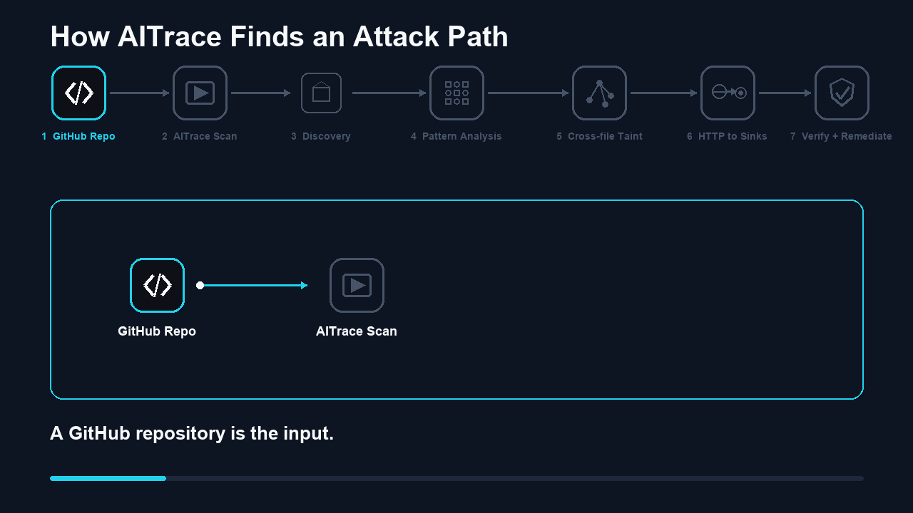

# AITrace — Attack Path Analysis and Exploit Synthesis for AI Applications

Traces user-controlled data through AI framework call chains **across files**, confirms which paths reach LLM / exec / SQL / MCP sinks, and can synthesize PoC payloads from those paths. Static analysis — no running application needed.

Supports LangChain · LangGraph · AutoGen · CrewAI · Semantic Kernel · LlamaIndex · Haystack · Pydantic AI · DSPy · MCP servers · OpenAI / Anthropic / Cohere / Vertex AI SDKs · ChromaDB · Pinecone · FAISS · Qdrant · guardrails · observability stacks and more.

---

## How it works



1. **Discovery** — Inventories AI packages (LLM SDKs, agents, vector stores, embeddings, guardrails, observability, MCP), model artifacts, and MCP server configs.
2. **Pattern analysis** — Flags structural shapes (PAT-001 … PAT-031): unsanitized RAG, PythonREPL/`exec`, SQL execute, RAG upload, MCP tool-return injection, lethal trifecta, secrets in prompts/KB, and more.
3. **Cross-file taint** — Builds a call graph and traces **values** (user input, LLM output, MCP tool args) to sinks. Confirmed payload paths become **FLOW-RCE**, **FLOW-SQL**, **FLOW-LLM**, **FLOW-HTTP**, **FLOW-EMAIL**, **FLOW-RAG**, with hop lists. Matching PAT hits are marked **taint confirmed**.
4. **Report** — Single `aitrace-report.html`: hybrid architecture overview, grouped findings (pattern / path confirmed / LLM verified), taint-path graph, optional exploits.
5. **Optional** — `--verify` (LLM semantic check), `--exploit` (PoC payloads), `--policy` (CI gate including AI controls).

---

## What it does

- **Traces attack paths** — Follows user input, env vars, tool args, and LLM output through AI framework calls across modules (not single-file grep)
- **Confirms reachability** — Value-taint analysis marks which paths actually reach LLM, agent, `exec`, SQL, HTTP, email, or RAG ingest sinks
- **Classifies findings** — `pattern` (shape only) vs `taint_confirmed` (traced hops) vs `llm_verified` (optional `--verify`)
- **Maps the AI stack** — LLM SDKs, agents, RAG, vector stores, MCP servers (including poisoned tool descriptions and hardcoded MCP secrets)
- **Risk score** — Execution / data / external exposure dimensions, including pattern and taint findings
- **Policy gate** — Licenses, models, severity, plus AI controls (`no_code_execution_tools`, `no_shadow_ai`, `mcp_trust_score_minimum`, `no_user_data_to_external_llm`, `no_hardcoded_credentials`)
- **Synthesizes exploits** — `--exploit` emits codebase-specific PoCs for confirmed sinks (CONFIRMED / LIKELY / UNCERTAIN)
- **Optional LLM verify** — `--verify` after `aitrace configure` (or env / `--secret-ref`); core scan never calls an API

---

## Installation

**Requirements:** Python 3.9+ · No telemetry · Core analysis makes no external API calls

**From source (recommended — latest code):**

```bash
git clone https://github.com/alishasinghania/AITrace-cli
cd AITrace-cli
pip install -e .
```

**LLM verification extra** (only needed for `--verify` / `aitrace configure`):

```bash
pip install -e ".[verify]"
```

**From PyPI:**

```bash
# Install uv (if not already installed)
curl -LsSf https://astral.sh/uv/install.sh | sh   # macOS / Linux
# or: pip install uv

uv tool install aitrace-cli
# or: pipx install aitrace-cli
```

> **Note:** The PyPI release may lag behind the GitHub repo. Install from source to get the latest features.

---

## Usage

```bash
# Scan a local repo — writes aitrace-report.html and opens it
aitrace scan ./my-app

# Scan a remote GitHub repo directly (shallow clone, no setup needed)
aitrace scan https://github.com/owner/repo
aitrace scan https://github.com/owner/repo --exploit

# Generate PoC payloads from confirmed paths
aitrace scan ./my-app --exploit

# Optional LLM verification of selected findings (requires configure or env)
aitrace configure --provider anthropic
aitrace scan ./my-app --verify
aitrace scan ./my-app --dry-run-verify   # show what would be sent, no API call

# Optional machine-readable outputs
aitrace scan ./my-app -f cyclonedx -f spdx -f mermaid -f risk-md
```

---

## Policy gate

Optional governance check for CI — not a substitute for path analysis:

```bash
aitrace init-policy
aitrace scan . --policy policy.yaml --no-open
```

Exit code `1` on violation. `init-policy` writes license / model / risk rules plus `ai_controls` (code-exec tools, shadow AI, MCP trust floor, user-data-to-LLM, hardcoded credentials).

Example GitHub Actions step:

```yaml
- name: AITrace policy gate
  run: aitrace scan . --policy policy.yaml --no-open
```

---

## Standards and References

AITrace provides best-effort support for [CycloneDX](https://cyclonedx.org/) 1.7 and [SPDX](https://spdx.dev/) 3.0.1 for optional AI BOM exports (`-f cyclonedx`, `-f spdx`). This does not imply full specification compliance or certification.

The project is motivated by the need for greater transparency in software supply chains, particularly around AI components that traditional SBOM approaches may not adequately describe, including LLM SDKs, agents, RAG pipelines, and MCP servers.

OWASP LLM Top 10 and CWE identifiers associated with findings are provided as contextual references, not as certified or authoritative vulnerability mappings.

---

## Disclaimer

AITrace is intended for security auditing and analysis of systems you own or have explicit permission to assess. Do not use it to analyze repositories or deployments without authorization. The authors are not responsible for unauthorized or improper use.

The `--exploit` option generates candidate proof-of-concept material to help investigate selected findings and potential attack paths. Generated payloads are not proof of exploitability and must be validated separately in a controlled environment. Treat them as sensitive security artifacts and do not use them against systems you do not own or have permission to test.

---

## Experimental Status

AITrace is experimental software focused on analyzing AI/LLM application source code, including attack paths, AI components, and MCP configurations. Its AI BOM export capabilities are also evolving alongside the underlying CycloneDX and SPDX specifications.

Optional CycloneDX and SPDX exports are best-effort outputs and are not guaranteed to be fully specification-compliant.

CLI flags, finding IDs, report layouts, and detection rules may change between releases. Detection coverage is not exhaustive, and findings require review and validation.

AITrace is intended as a research and security auditing aid, not as a compliance certificate or a replacement for manual security assessment.
